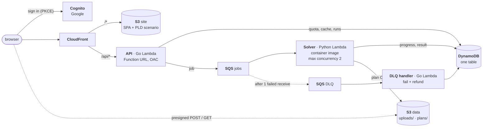
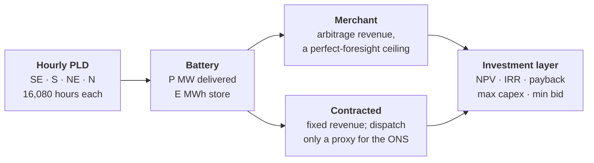
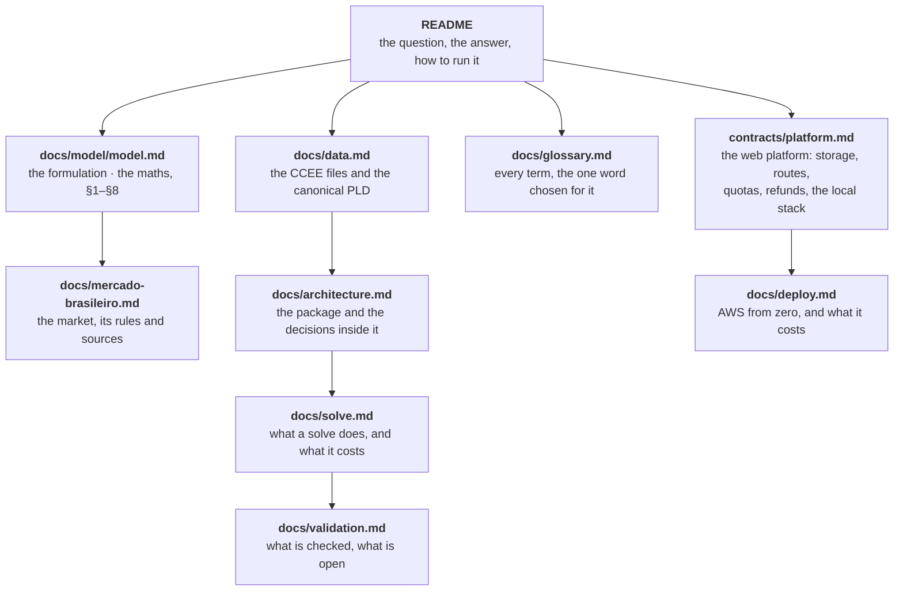

# BatteryPlan

Is this battery worth buying, in which Brazilian submarket, and under which
business model? BatteryPlan values a battery against the hourly PLD of Brazil's
four submarkets, as a capacity contract and as a merchant asset, and serves it as
a small serverless web app: size the battery, change the financial assumptions
and see NPV, IRR and payback move instantly.

**Site:** <https://batteryplan.gmachado.dev> · **Method:** [`docs/model/model.md`](docs/model/model.md)

- One battery in one submarket (SE, S, NE or N), valued as two separate cases:
  **contracted** (LRCAP fixed revenue, with the PLD dispatch only a proxy for the
  ONS) and **merchant** (PLD arbitrage, no fixed revenue).
- Eight solutions per run (4 submarkets × 2 cases), each one program over the whole
  horizon. The location ranking comes from the merchant case.
- An instant financial layer in the browser, in BRL: NPV, IRR, payback, maximum
  viable capex and minimum viable bid, with IPCA, a nominal discount rate and real
  PLD growth.
- Market facts and sources: [`docs/mercado-brasileiro.md`](docs/mercado-brasileiro.md).
  Official auction documents: [`docs/leilao-lrcap-2026/`](docs/leilao-lrcap-2026/README.md).

## Architecture



The browser polls `GET /api/runs/{id}` every 3 s while a run is queued or running;
the solver writes its progress to the run's item at most every 3 s. Payloads are
fixed by the JSON Schemas in [`contracts/`](contracts/README.md), and everything
around them (table items, routes, error codes, the refund rule, the local stack)
by [`contracts/platform.md`](contracts/platform.md). Terraform in `infra/`,
deployed by GitHub Actions through OIDC, with no long-lived AWS keys.

## Why it's built this way

- **Serverless, so idle costs nothing.** Every piece bills per request or per
  GB-second, and at portfolio traffic nearly all of it sits in free tiers: expect
  US$ 1–3 a month. The worst case the caps allow (60 runs a day, each running to
  the solver's 10-minute timeout) is about US$ 20 a month of Lambda, and an AWS
  Budgets alert at US$ 5 is there to catch it. EC2, a modular monolith on one
  box, Postgres and Amplify were all considered; each puts a fixed monthly bill
  under a site that is idle most of the day.
- **SQS, not RabbitMQ or Kafka.** A run is a task to be done once, not an event
  to be replayed, so it needs a queue rather than a log, and SQS is the one that
  costs nothing when empty, bills per message and needs no broker to run. Its
  redrive policy (`maxReceiveCount = 1`) moves a crashed job to the DLQ, where a
  Go Lambda fails the run and gives the quota back.
- **Go for the API, Python for the model.** The API is on the request path, so
  it is a static arm64 binary with cold starts in milliseconds and 256 MB of
  memory. The model stays in Python, where pulp and HiGHS are, and runs as a
  container image at 1769 MB, the size at which Lambda grants one full vCPU.
- **Runs span one to two years.** The balanced year needs all twelve months, and
  two years keeps the worst case inside the solver's 10 minutes on one Lambda vCPU.
  The eight programs over all 670 days take about 17 s on a development machine,
  and the slowest forced contract case about a minute
  ([`docs/solve.md`](docs/solve.md)).
- **Every run is solved against the Lambda's time limit.** The portfolio gets the
  invocation's remaining time. A solve that runs out fails the run and refunds the
  quota rather than returning a partial plan.
- **Finance never reaches the solver.** The request is physical only, so a change
  of capex, IPCA or discount rate recalculates in the browser, with no run, no
  quota and no sign-in.
- **Rate limiting in layers**, each cheaper than the one behind it:
  the Function URL accepts only requests CloudFront signed (OAC); 60 requests a
  minute per IP; sign-in required to submit; 3 runs a day per user; 60 runs a day
  for the whole site; at most 2 solves at once (the queue's maximum concurrency,
  whatever its depth); the API's reserved concurrency of 10; the budget alert.
  Quota and global counters move in one DynamoDB transaction with the run, and
  come back exactly once when a run fails, whoever fails it.
- **Results cached by a hash of the parameters.** An identical request returns
  the existing run (`cached: true`) without spending quota or solving again.
- **One set of schemas for three languages.** The JSON Schemas in `contracts/`
  are embedded in the Go API (a test fails when the copies drift), validated by
  the Python solver, and read by the TypeScript form for its bounds and defaults.
- **Runs without an AWS account.** `docker compose up` brings up LocalStack (SQS,
  DynamoDB, S3), the API as a plain HTTP server, and the DLQ handler and the
  solver as queue pollers that call the same handlers the Lambdas do.

## The model in brief

A battery buys and sells at the hourly PLD of one submarket. Energy is lost on the
way in and on the way out, and every cycle wears the asset a little.



Three consequences shape the rest:

- **No binary keeps charge and discharge apart.** With positive prices and a real
  loss, no optimal plan does both in one hour (§5.1), so the merchant case is a
  plain LP: about 2 s for 670 days.
- **The contract adds limits, and one binary.** Daily and rolling yearly cycles are
  linear. The 12 h daily injection limit needs a binary, and it is added only on
  the days whose relaxed plan breaks it. On the real data none does.
- **The two cases cannot be added.** The contract centralises the dispatch in the
  ONS and sends the PLD settlement to the CONCAP, so a contracted battery earns no
  arbitrage.

For a battery delivering 1 MW for 4 h at the default parameters, over the 670 days
of CCEE data ([`docs/solve.md`](docs/solve.md)):

| Submarket | Merchant, balanced year (BRL/MW-year) | Last 12 months | Capture factor (24+0) |
| --- | --: | --: | --: |
| SE | 244,503 | 298,920 | 0.981 |
| NE | 223,802 | 271,736 | 0.965 |
| N | 211,907 | 270,095 | 0.966 |
| S | 201,233 | 224,983 | 0.974 |

These are perfect-foresight ceilings before the capture factor. The capture factor
is itself an upper bound, since the backtest sees each day's prices in full.

The model lives in `src/battery_plan/`, and the formulation it implements is written
out section by section in [`docs/model/model.md`](docs/model/model.md). On the site,
the [methodology page](https://batteryplan.gmachado.dev/methodology) renders §1–§6
and §8 of the same file.

## Repository layout

```
src/battery_plan/     the model: the hourly PLD, one program per submarket and
                      case, the portfolio, the result payload, the params hash
services/api/         Go: the HTTP API (Lambda Function URL / plain server) and
                      the DLQ handler
services/solver/      Python: the SQS-driven solver Lambda and its local poller
web/                  React 19 + Vite + TypeScript: dashboard, investment layer,
                      run form, progress, methodology
contracts/            JSON Schemas shared by Go, Python and TypeScript, their
                      examples, platform.md (storage, routes, refunds)
infra/aws/            Terraform: CloudFront, S3, Lambdas, SQS, DynamoDB, Cognito,
                      budget, custom domain
infra/bootstrap/      Terraform applied once: state bucket, GitHub OIDC, deploy
                      role, ECR
infra/local/          LocalStack init script
docker-compose.yml    the whole back end against LocalStack
.github/workflows/    CI (Python, Go, web, Terraform) and deploy
tests/                the Python suite, described in docs/validation.md
docs/                 the model, the market and its official documents,
                      architecture, deploy; see "Where to read what" below
scripts/              builders of the derived files and the measurement run
data/raw/             the CCEE exports and the canonical hourly PLD
```

The Python package file by file is in [`docs/architecture.md`](docs/architecture.md).

## Run it locally

The toolchain is pinned in `mise.toml` (node, pnpm, go, terraform); Python and
its dependencies come from `uv`. Docker runs the back end.

```bash
mise install                     # node, pnpm, go, terraform
uv sync --all-groups             # Python 3.12 and the model's dependencies

docker compose up -d --build     # LocalStack, the Go API on :8080, the DLQ handler, the solver
cd web && mise exec -- pnpm install
VITE_AUTH_MODE=dev mise exec -- pnpm dev   # http://localhost:5173, /api proxied to :8080
```

The dev build signs in with any name and email, which the API accepts only with
`AUTH_MODE=dev`. `services/api/scripts/smoke.sh` exercises the stack end to end;
`docker compose down` stops it. Without any back end, `pnpm dev:mock` plays the
API inside the tab ([`web/README.md`](web/README.md)).

The model also runs on its own, from the command line:

```bash
uv run battery-plan inputs                                        # coverage and level of the PLD
uv run battery-plan dispatch --start 2025-02-01 --end 2026-01-31  # a year
uv run battery-plan dispatch                                      # all 670 days
```

Every flag and the Docker image are in [`docs/cli.md`](docs/cli.md).

## Deploy

[`docs/deploy.md`](docs/deploy.md): bootstrap once (state bucket, GitHub OIDC
provider, deploy role, ECR), the Google app, the repository's
secrets and variables, then every push to `main` builds the solver image and the
Go zips, applies Terraform and publishes the SPA. It also covers the custom
domain on Cloudflare DNS, the OAC gotchas and the cost.

## Tests

```bash
uv run pytest                                   # the model, contracts and solver handler (moto)
cd services/api && go test ./...                # the API; DynamoDB tests use dynamodb-local in docker
cd web && mise exec -- pnpm lint && mise exec -- pnpm test   # eslint + tsc, vitest
```

CI runs all three, plus `terraform fmt` and `validate`, on every pull request.
[`docs/validation.md`](docs/validation.md) describes what the model's tests pin
down, what checking found that thinking had not, and what is still open.

## Where to read what



| Document | Read it for |
| --- | --- |
| [`docs/model/model.md`](docs/model/model.md) | The formulation: objective, contract limits, assumptions and the investment layer, numbered §1–§8. |
| [`docs/mercado-brasileiro.md`](docs/mercado-brasileiro.md) | The PLD, the CCEE files, the LRCAP rules with their clauses, costs and sources (in Portuguese). |
| [`docs/leilao-lrcap-2026/README.md`](docs/leilao-lrcap-2026/README.md) | Index of the official auction documents: title, date, source URL, `IdMidia`, SHA-256. |
| [`docs/data.md`](docs/data.md) | The CCEE exports, how the canonical file is built, and what an upload must satisfy. |
| [`docs/architecture.md`](docs/architecture.md) | How the Python package is structured, and the decisions inside it. |
| [`docs/solve.md`](docs/solve.md) | One program per submarket and case: solve times, the 12 h limit under stress, and the capture factor. |
| [`docs/glossary.md`](docs/glossary.md) | Every term the model, the code and the write-up use, with the one word chosen for each idea. |
| [`docs/validation.md`](docs/validation.md) | The model's tests, and the questions still open. |
| [`docs/cli.md`](docs/cli.md) | The command line: every flag, the derived files, the Docker image. |
| [`contracts/README.md`](contracts/README.md) | The four JSON Schemas, their fields and units, the cross-field rules, the uploaded price format, the params hash. |
| [`contracts/platform.md`](contracts/platform.md) | What the services share beyond the schemas: the DynamoDB items, the HTTP routes and error codes, submitting, finishing and refunding a run, the local stack, AWS sizing. |
| [`services/api/README.md`](services/api/README.md), [`services/solver/README.md`](services/solver/README.md), [`web/README.md`](web/README.md) | Each service: its packages or files, its configuration, how to run and test it on its own. |
| [`docs/deploy.md`](docs/deploy.md) | Deploying to AWS from an empty account, the custom domain, how the pieces fit, and the cost. |
