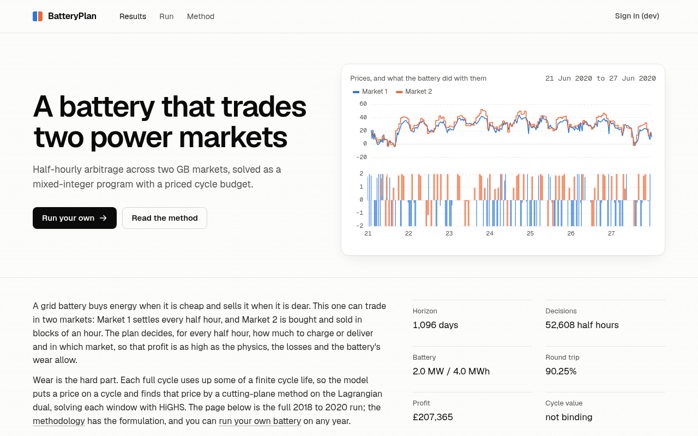
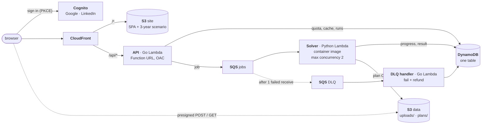
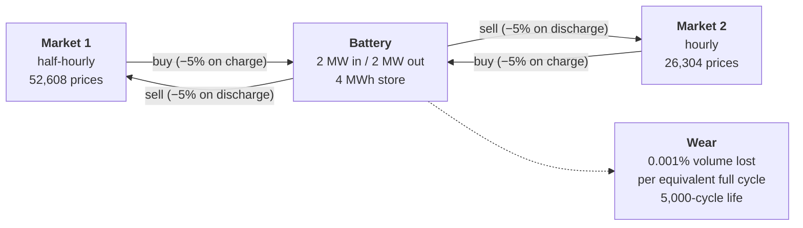
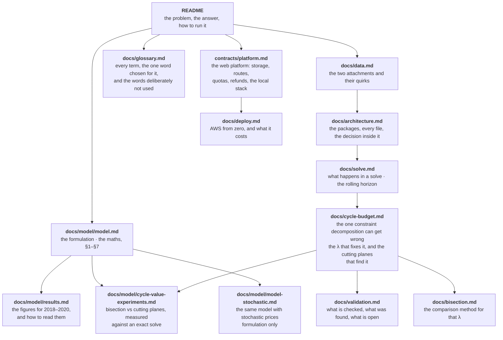

# BatteryPlan

A battery that trades two GB power markets, planned half hour by half hour.
BatteryPlan solves the dispatch as a mixed-integer linear program (pulp + HiGHS)
over rolling windows, prices the battery's cycle budget with Lagrangian cutting
planes, and serves it as a small serverless web app: change the battery, pick up
to a year of 2018–2020 prices or upload your own, and watch the solve run.

**Site:** <https://batteryplan.gmachado.dev> · **Method:** [`docs/model/model.md`](docs/model/model.md)



*The local stack (LocalStack, the Go API, the Python solver) with the dev sign-in: the
precomputed three-year dashboard, a 46-day run with a 10-cycle budget, the cutting
plane's passes as they arrive, the result. Sped up 1.25×.*

## Architecture



The browser polls `GET /api/runs/{id}` every 3 s while a run is queued or running;
the solver writes its progress to the run's item at most every 3 s. Payloads are
fixed by the JSON Schemas in [`contracts/`](contracts/README.md), and everything
around them (table items, routes, error codes, the refund rule, the local stack)
by [`contracts/platform.md`](contracts/platform.md). Terraform in `infra/`,
deployed by GitHub Actions through OIDC, with no long-lived AWS keys.

## Why it's built this way

- **Serverless, so idle costs nothing.** Every piece bills per request or per
  GB-second, and at portfolio traffic nearly all of it sits in free tiers: expect
  US$ 1–3 a month. The worst case the caps allow (60 runs a day, each running to
  the solver's 10-minute timeout) is about US$ 20 a month of Lambda, and an AWS
  Budgets alert at US$ 5 is there to catch it. EC2, a modular monolith on one
  box, Postgres and Amplify were all considered; each puts a fixed monthly bill
  under a site that is idle most of the day.
- **SQS, not RabbitMQ or Kafka.** A run is a task to be done once, not an event
  to be replayed, so it needs a queue rather than a log, and SQS is the one that
  costs nothing when empty, bills per message and needs no broker to run. Its
  redrive policy (`maxReceiveCount = 1`) moves a crashed job to the DLQ, where a
  Go Lambda fails the run and gives the quota back.
- **Go for the API, Python for the model.** The API is on the request path, so
  it is a static arm64 binary with cold starts in milliseconds and 256 MB of
  memory. The model stays in Python, where pulp and HiGHS are, and runs as a
  container image at 1769 MB, the size at which Lambda grants one full vCPU.
- **Runs are capped at one year.** A Lambda lives at most 15 minutes (the solver
  is given 10), and a binding cycle budget takes about ten passes of the rolling
  horizon to price. A year prices in nine passes, about 100 s on a laptop; three
  years take ten passes and 7 min 20 s
  ([measured](docs/model/cycle-value-experiments.md)), with no margin on one
  Lambda vCPU. So the three-year scenario is solved once, offline, and served as
  a static file.
- **Every run is solved against the Lambda's time limit.** Before each round of
  the cycle-value search the solver checks that one more pass and the recovery
  pass still fit in the time left; if they don't, it stops early and still
  delivers a plan within the cycle budget. The result page says so, and shows how
  close that plan is to the best possible from the dual bound.
- **The window is fixed for web runs.** Each day is planned with the next day in
  view (commit 1 day, lookahead 1 day). Longer windows add nothing on this data
  ([`docs/solve.md`](docs/solve.md), §6 of the method) and only cost time against
  that limit, so the form doesn't offer them; the CLI still does.
- **Rate limiting in layers**, each cheaper than the one behind it:
  the Function URL accepts only requests CloudFront signed (OAC); 60 requests a
  minute per IP; sign-in required to submit; 3 runs a day per user; 60 runs a day
  for the whole site; at most 2 solves at once (the queue's maximum concurrency,
  whatever its depth); the API's reserved concurrency of 10; the budget alert.
  Quota and global counters move in one DynamoDB transaction with the run, and
  come back exactly once when a run fails, whoever fails it.
- **Results cached by a hash of the parameters.** An identical request returns
  the existing run (`cached: true`) without spending quota or solving again.
- **One set of schemas for three languages.** The JSON Schemas in `contracts/`
  are embedded in the Go API (a test fails when the copies drift), validated by
  the Python solver, and read by the TypeScript form for its bounds and defaults.
- **Runs without an AWS account.** `docker compose up` brings up LocalStack (SQS,
  DynamoDB, S3), the API as a plain HTTP server, and the DLQ handler and the
  solver as queue pollers that call the same handlers the Lambdas do. The demo
  above was recorded on it.

## The model in brief

The battery (2 MW in, 2 MW out, 4 MWh) buys and sells in two markets. Market 1
settles every half hour; Market 2 settles hourly, so anything committed to it is
committed for the whole hour. Energy is lost on the way in and on the way out,
and every MWh pushed through wears the asset out a little.



Three consequences shape the rest:

- **A round trip keeps only 90.25%** of what it buys (0.95 × 0.95), so a spread
  has to beat about 11% before a trade is worth making.
- **Charging and discharging must be mutually exclusive.** The two markets
  diverge, so without a binary forbidding it the battery would buy in one and
  sell into the other in the same instant, wheeling energy it never stores.
- **Market 2's decisions are held flat across each hour**, imposed on the
  decision variables rather than on the prices, because that is what committing
  capacity to an hourly product means.

The decision variables are half-hourly charge and discharge in each market; the
constraints are storage bounds, the energy balance with losses, mode exclusivity
and rate limits, the hourly commitment of Market 2, cycle accounting with a life
cap, and storage degradation (§4.1–§4.7 of [`model.md`](docs/model/model.md));
the objective is arbitrage profit net of cycle wear. One program over all 52,608
periods, each carrying a binary, is not tractable, so **the horizon is
decomposed** into windows, by default a day committed with a day of foresight:
1,096 window MILPs over three years.

Decomposition gets one thing wrong on its own: a cycle budget over the whole
horizon, which no single window can see. The model relaxes it with a Lagrange
multiplier, a price λ on each cycle, and finds λ with Kelley's cutting planes,
which also return a dual bound on how far the plan can be from the optimum
([`docs/cycle-budget.md`](docs/cycle-budget.md)). A bisection on λ is kept as the
reference method ([`docs/bisection.md`](docs/bisection.md)).

Over 2018–2020 with the full cycle budget
([`docs/model/results.md`](docs/model/results.md)):

| Figure | Value |
| --- | --- |
| **Profit** | **£207,365** |
| Energy bought / delivered | 14,495 MWh at £34.98 / 13,082 MWh at £54.61 |
| Equivalent full cycles | 3,443 of 5,000 (the budget does not bind) |
| Storage volume at the end | 3.86 MWh, from 4.00 nominal |

The model lives in `src/battery_plan/`, the formulation it implements is written
out section by section in [`docs/model/model.md`](docs/model/model.md), and every
number quoted in the documents comes from a committed run. On the site, the
[methodology page](https://batteryplan.gmachado.dev/methodology) renders §1–§6 of
the same file.

## Repository layout

```
src/battery_plan/     the model: formulation, rolling horizon, cycle-value search,
                      run_dispatch (what the CLI and the web solver both call),
                      the result payload, the params hash
services/api/         Go: the HTTP API (Lambda Function URL / plain server) and
                      the DLQ handler
services/solver/      Python: the SQS-driven solver Lambda and its local poller,
                      the script that precomputes the 3-year scenario
web/                  React 19 + Vite + TypeScript: dashboard, run form,
                      progress, methodology
contracts/            JSON Schemas shared by Go, Python and TypeScript, their
                      examples, platform.md (storage, routes, refunds)
infra/aws/            Terraform: CloudFront, S3, Lambdas, SQS, DynamoDB, Cognito,
                      budget, custom domain
infra/bootstrap/      Terraform applied once: state bucket, GitHub OIDC, deploy
                      role, ECR
infra/local/          LocalStack init script
docker-compose.yml    the whole back end against LocalStack
.github/workflows/    CI (Python, Go, web, Terraform) and deploy
tests/                the Python suite, described in docs/validation.md
docs/                 the model, its results and experiments, architecture,
                      deploy; see "Where to read what" below
notebooks/, scripts/  the analysis notebook and the measurement runs behind
                      the documents
data/raw/             the two spreadsheets supplied with the exercise
```

The Python package file by file is in [`docs/architecture.md`](docs/architecture.md).

## Run it locally

The toolchain is pinned in `mise.toml` (node, pnpm, go, terraform); Python and
its dependencies come from `uv`. Docker runs the back end.

```bash
mise install                     # node, pnpm, go, terraform
uv sync --all-groups             # Python 3.12 and the model's dependencies

docker compose up -d --build     # LocalStack, the Go API on :8080, the DLQ handler, the solver
cd web && mise exec -- pnpm install
VITE_AUTH_MODE=dev mise exec -- pnpm dev   # http://localhost:5173, /api proxied to :8080
```

The dev build signs in with any name and email, which the API accepts only with
`AUTH_MODE=dev`. `services/api/scripts/smoke.sh` exercises the stack end to end;
`docker compose down` stops it. Without any back end, `pnpm dev:mock` plays the
API inside the tab ([`web/README.md`](web/README.md)).

The model also runs on its own, from the command line:

```bash
uv run battery-plan inputs                                        # spec + data quality
uv run battery-plan dispatch --start 2018-01-01 --end 2018-01-31  # a month
uv run battery-plan dispatch                                      # all three years, a few minutes
```

Every flag, the search comparisons, `make results` (re-running every figure in the
documents) and the Docker image are in [`docs/cli.md`](docs/cli.md).

## Deploy

[`docs/deploy.md`](docs/deploy.md): bootstrap once (state bucket, GitHub OIDC
provider, deploy role, ECR), the Google and LinkedIn apps, the repository's
secrets and variables, then every push to `main` builds the solver image and the
Go zips, applies Terraform and publishes the SPA. It also covers the custom
domain on Cloudflare DNS, the OAC gotchas and the cost.

## Tests

```bash
uv run pytest                                   # the model, contracts and solver handler (moto)
cd services/api && go test ./...                # the API; DynamoDB tests use dynamodb-local in docker
cd web && mise exec -- pnpm lint && mise exec -- pnpm test   # eslint + tsc, vitest
```

CI runs all three, plus `terraform fmt` and `validate`, on every pull request.
[`docs/validation.md`](docs/validation.md) describes what the model's tests pin
down, what checking found that thinking had not, and what is still open.

## Where to read what



| Document | Read it for |
| --- | --- |
| [`docs/model/model.md`](docs/model/model.md) | The formulation: objective, constraints, assumptions, numbered §1–§7. Every module cites it. |
| [`docs/model/results.md`](docs/model/results.md) | §7: profit, energy, cycles and degradation over 2018–2020, year by year, with the reading of them. |
| [`docs/model/model-stochastic.md`](docs/model/model-stochastic.md) | The multistage stochastic extension: scenario tree, non-anticipativity, the cycle cap under uncertainty, mean-CVaR. Formulation only, nothing implemented. |
| [`docs/data.md`](docs/data.md) | What the two spreadsheets contain, the clock-change artefacts, and why the loader reports rather than repairs. |
| [`docs/architecture.md`](docs/architecture.md) | How the Python package is structured, every class with the reason it exists, why the constraints are separate blocks, and how two search algorithms share one seam. |
| [`docs/solve.md`](docs/solve.md) | Why the horizon is decomposed, what one window does, and the evidence that a day of foresight suffices. |
| [`docs/cycle-budget.md`](docs/cycle-budget.md) | The global cycle cap, the misallocation decomposition causes, valuing cycles instead of splitting them, and how λ is found by the default method: Kelley's cutting planes. |
| [`docs/bisection.md`](docs/bisection.md) | The second method for the same λ, kept for comparison: what a bisection on cycle use searches for, what it costs, and what it cannot certify. |
| [`docs/model/cycle-value-experiments.md`](docs/model/cycle-value-experiments.md) | Why a capped pass has no usable gradient, and both search methods measured against exactly solved instances: passes, λ, profit and the dual bound. |
| [`docs/model/tractability.md`](docs/model/tractability.md) | Solve time against window length, and the whole horizon as one MILP: the measurements behind decomposing it. |
| [`docs/glossary.md`](docs/glossary.md) | Every term the model, the code and the write-up use, the one word chosen for each idea, and the renames that choice implied. |
| [`docs/validation.md`](docs/validation.md) | The model's tests, what checking found that thinking had not, and the questions still open. |
| [`docs/cli.md`](docs/cli.md) | The command line: every flag, the search comparisons, reproducing every figure, the Docker image. |
| [`notebooks/02_results_analysis.ipynb`](notebooks/02_results_analysis.ipynb) | The dispatch read off the committed plan: every figure in `results.md` re-derived and diffed against the documented value, then the behaviour the prose only asserts — the price landscape, what the plan does with it, where the profit comes from, the cycle budget that did not bind, and the solver evidence. Solves nothing; runs in seconds. |
| [`contracts/README.md`](contracts/README.md) | The four JSON Schemas, their fields and units, the cross-field rules, the uploaded price format, the params hash. |
| [`contracts/platform.md`](contracts/platform.md) | What the services share beyond the schemas: the DynamoDB items, the HTTP routes and error codes, submitting, finishing and refunding a run, the local stack, AWS sizing. |
| [`services/api/README.md`](services/api/README.md), [`services/solver/README.md`](services/solver/README.md), [`web/README.md`](web/README.md) | Each service: its packages or files, its configuration, how to run and test it on its own. |
| [`docs/deploy.md`](docs/deploy.md) | Deploying to AWS from an empty account, the custom domain, how the pieces fit, and the cost. |
