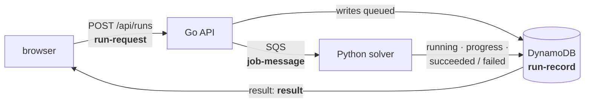

# Contracts

The JSON Schemas (draft 2020-12) the Go API and the Python solver both code
against, in [`v2/`](v2/). They are the source of truth: when a schema and either
side disagree, the side is wrong.

| Schema | What it is | Written by | Read by |
| --- | --- | --- | --- |
| [`run-request.schema.json`](v2/run-request.schema.json) | Body of `POST /api/runs`: the physical battery, the dates, and optionally a cycle budget and an uploaded price file | browser | API, solver |
| [`job-message.schema.json`](v2/job-message.schema.json) | The SQS message for one run: versions, `run_id`, `params_hash`, the validated request, where the prices are, the user's `sub` | API | solver |
| [`run-record.schema.json`](v2/run-record.schema.json) | The run as stored in DynamoDB and returned by the API: status, progress, error, timestamps, result, the plan CSV's S3 key | API, solver | API |
| [`result.schema.json`](v2/result.schema.json) | What `battery_plan.result_v2.build_result` returns: the ranking, the aggregates of every case and the detail of one | solver | browser |

`$id`s live under `https://batteryplan.invalid/contracts/` — identifiers, not
locations; `.invalid` never resolves. The `$ref`s between files are relative, so
load all four into the validator's registry under their `$id`s rather than letting
it fetch anything.

Every example in [`examples/v2/`](examples/v2/) is written by
`uv run python scripts/contract_examples_v2.py` from a real solve and checked by
`tests/test_contracts.py` and the Go tests. A message of any other version or model
is refused: the run fails with `request_invalid` and its quota comes back.

## run-request

The request is **physical only**: financial inputs never enter it or the params
hash, because they run in the browser and need no solve.

| Field | Unit | Min | Max |
| --- | --- | ---: | ---: |
| `battery.power_mw` | MW delivered to the grid | 0.1 | 2,000 |
| `battery.volume_mwh` | MWh, nominal | 0.1 | 60,000 |
| `battery.max_charge_mw` | MW, grid side | 0.1 | 20,000 |
| `battery.max_discharge_mw` | MW, storage side | 0.1 | 20,000 |
| `battery.charge_efficiency` | one-way share | 0.5 | 1 |
| `battery.discharge_efficiency` | one-way share | 0.5 | 1 |
| `battery.degradation_pct_per_cycle` | **percent** of volume per cycle | 0 | 0.1 |
| `cycle_budget` *(optional)* | physical cycles over the run's horizon | 1 | 100,000 |
| `start`, `end` | `YYYY-MM-DD`, `end` inclusive of its whole day | | |
| `prices_key` *(optional)* | S3 key of an uploaded CSV | | absent → the bundled PLD |

All battery fields are required. Optional fields are **omitted, never `null`**.

Rules the schema cannot state, which the API checks before queueing:

- `start <= end`, and the run spans 365 to 731 days inclusive, since the balanced
  year needs all twelve months and the ceiling keeps the worst case inside a Lambda;
- on the bundled prices, `2025-01-20 <= start` and `end <= 2026-11-20`;
- on an upload, both dates inside the file's span. This one is the solver's: it
  fails the run with `error.code = "request_invalid"`.

## Uploaded prices

A CSV with the header `hora,submercado,pld`: one row per hour and submarket, `hora`
as local market time `YYYY-MM-DDTHH:00` with no offset, `submercado` one of SE, S,
NE or N, and `pld` in BRL/MWh, greater than zero. The file holds whole days.
[`examples/pld-template.csv`](examples/pld-template.csv) is a valid file for the
site to offer as a download.

The check exists in Python, Go and TypeScript (`check_pld_csv`, `CheckPLD`,
`checkPldCsv`) with messages in the same words, and all three must return the
verdicts in [`examples/pld-upload-verdicts.json`](examples/pld-upload-verdicts.json).
The solver stores a rejection as `error.message` with
`error.code = "prices_invalid"`.

## job-message

`version` and `model_version` must be the solver's own. `prices` is
`{"source": "bundled"}` or `{"source": "s3", "bucket": ..., "key": ...}`, and
`request` is the validated request as received, `prices_key` included.

## run-record

`status` moves `queued → running → succeeded | failed`, and the schema requires
what each state implies: `started_at` once running; `finished_at`, `result` and
`plan_csv_key` on success; `finished_at` and `error` on failure. `progress` is
written once per program:

| Field | Meaning |
| --- | --- |
| `phase` | `solving`, `done` |
| `cases_done` | programs finished |
| `cases_total` | 8, or 4 when the battery cannot meet the contract |
| `submarket`, `case` | the program in flight; `null` once done |
| `fraction` | share of the run done |
| `elapsed` | seconds since the solve started |
| `done` | the run has finished |
| `updated_at` | when this was written |

## result

| Block | What it holds |
| --- | --- |
| `horizon`, `battery` | What was solved, with the derived duration and contract cycles per physical cycle |
| `eligibility` | Whether the battery can meet the contract, why not, and the auction's minimum power |
| `ranking` | Submarkets by merchant value, with the balanced year, the last twelve months and the regret |
| `cases` | Aggregates of each solved case, with its monthly block for the financial layer |
| `detail` | Daily series, mean-day profile, a week and the net-power heatmap of **one** case: the merchant case of the top-ranked submarket |

Only one case carries detail because a DynamoDB item is limited to 400 KB. A
result stays at or below 300 KB as compact JSON, and the solver stores it as one
string attribute. The full plans of every case are in the plan CSV.

## The params hash

Identifies a run by what it computes, so a repeated request can be answered from
an earlier run. Both sides compute it the same way:

1. Take the validated request and remove `prices_key`. Where a file is stored says
   nothing about what is in it.
2. Take the prices' content hash: lowercase hex sha256 of the CSV's bytes as stored
   in S3, or, for the bundled prices, the constant
   `2431c61473ae39b0ed949364306974e6ee8b5b88d8d051d6bedb19a688c9b839`
   (sha256 of `data/raw/pld_hourly.csv`,
   `battery_plan.contracts.BUNDLED_PLD_SHA256`).
3. Build `{"model_version": <version>, "prices_sha256": <hash>, "request": <request>}`
   and serialise it as canonical JSON per
   [RFC 8785](https://www.rfc-editor.org/rfc/rfc8785) (JCS): keys sorted, no
   whitespace, no escaping beyond what JSON requires, and numbers as ECMAScript
   prints them — `5000`, not `5000.0`; `0.000005`, not `5e-06`.
4. `params_hash` = lowercase hex sha256 of that string's UTF-8 bytes.

Python: `battery_plan.contracts.params_hash(request, prices_sha256)`. Go:
`contracts.ParamsHash`. Both are checked against
[`examples/v2/params-hash.json`](examples/v2/params-hash.json), which gives each
vector's request, prices hash, canonical string and expected hash:

| Vector | `params_hash` |
| --- | --- |
| bundled prices | `b4179fe898f1955655a0413b1e4e21624d000af3d8b01b8a6af044001388a6fd` |
| uploaded prices: prices_key is left out, the file's sha256 stands in | `630612da4338cfe570eaf7ed0bae1dfb99771ecb3c277b6a492cce215c14d419` |
