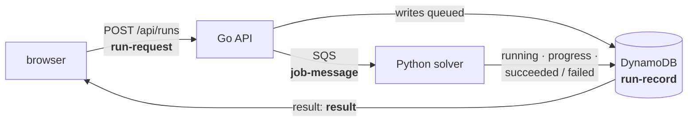

# Contracts

The JSON Schemas (draft 2020-12) the Go API and the Python solver both code
against. They are the source of truth: when a schema and either side disagree,
the side is wrong.

| Schema | What it is | Written by | Read by |
| --- | --- | --- | --- |
| [`run-request.schema.json`](run-request.schema.json) | Body of `POST /api/runs`: the battery, the dates, and optionally a cycle budget and an uploaded price file | browser | API, solver |
| [`job-message.schema.json`](job-message.schema.json) | The SQS message for one run: `run_id`, `params_hash`, the validated request, where the prices are, the user's `sub` | API | solver |
| [`run-record.schema.json`](run-record.schema.json) | The run as stored in DynamoDB and returned by the API: status, progress, error, timestamps, result, the plan CSV's S3 key | API, solver | API |
| [`result.schema.json`](result.schema.json) | Exactly what `battery_plan.analysis.build_result_payload` returns: headline figures and the series the results page draws | solver | browser |

`$id`s live under `https://batteryplan.invalid/contracts/` — identifiers, not
locations; `.invalid` never resolves. The `$ref`s between files are relative
(`run-request.schema.json`), so load all four into the validator's registry
under their `$id`s rather than letting it fetch anything.

Every example in [`examples/`](examples/) is written by
`uv run python scripts/contract_examples.py` from a real run and validated by
`tests/test_contracts.py`, which also validates a freshly built result payload.

## run-request

The battery fields are named after `battery_plan.data_models.BatterySpec` and
carry its units, so the solver builds the spec with `BatterySpec(**battery)`
(`battery_plan.contracts.spec_from_request`).

| Field | Unit | Min | Max | Battery spec |
| --- | --- | ---: | ---: | ---: |
| `battery.max_charge_rate_mw` | MW | 0.1 | 100 | 2 |
| `battery.max_discharge_rate_mw` | MW | 0.1 | 100 | 2 |
| `battery.max_storage_volume_mwh` | MWh | 0.1 | 400 | 4 |
| `battery.charging_loss_fraction` | fraction lost (0.05 = 95% efficient) | 0 | 0.5 | 0.05 |
| `battery.discharging_loss_fraction` | fraction lost | 0 | 0.5 | 0.05 |
| `battery.lifetime_years` | years | 1 | 50 | 10 |
| `battery.lifetime_cycles` | equivalent full cycles | 1 | 100,000 | 5,000 |
| `battery.degradation_pct_per_cycle` | **percent** of volume per cycle | 0 | 0.1 | 0.001 |
| `battery.capex_gbp` | GBP | 0 | 10⁹ | 500,000 |
| `battery.fixed_opex_gbp_per_year` | GBP/year | 0 | 10⁸ | 5,000 |
| `cycle_budget` *(optional)* | cycles over the run's horizon | 1 | 100,000 | absent → `lifetime_cycles` |
| `start`, `end` | `YYYY-MM-DD`, `end` inclusive of its whole day | | | |
| `prices_key` *(optional)* | S3 key of an uploaded CSV | | | absent → bundled prices, where the deployment has them; otherwise rejected |

All battery fields are required; the schema's `default`s are what the form
should pre-fill, not values either side fills in. There is no `search` field:
every web run uses cutting planes. There is no window scheme either: every
web run commits one day at a time with the next day in view
(`battery_plan.contracts.config_from_request`). §6 of
[`docs/model/model.md`](../docs/model/model.md), "How much foresight is
enough", shows that longer lookahead or longer commits add nothing on this
data. A request that carries `commit_days` or `lookahead_days` is rejected
like any other unknown field. Optional fields are **omitted, never
`null`**.

Rules the schema cannot state, which the API checks before queueing:

- `start <= end`, and `end - start <= 365` days (so at most 366 calendar days);
- on the bundled prices, `2018-01-01 <= start` and `end <= 2020-12-31`;
- on an upload, both dates inside the file's span. The API does not parse the
  file, so this one is the solver's: it fails the run with
  `error.code = "request_invalid"`.

## Uploaded prices

A CSV with the header `timestamp,market_1,market_2`, one row per half hour:
`timestamp` in ISO 8601 (an offset is converted to UTC and dropped),
`market_1` the half-hourly price, `market_2` the hourly price repeated on both
half hours of its hour, both in GBP/MWh.
[`examples/prices-template.csv`](examples/prices-template.csv) is January 2018
in that format, for the site to offer as a download.

`battery_plan.data_io.load_market_prices_csv` rejects a file with a
`PriceFileError` whose message is written for the user and names the line to
fix: a missing column, a cell that is not a number or a timestamp, a duplicate,
a gap, rows out of order, a timestamp off the half hour, a file that does not
start on the hour and end on the half hour, or a `market_2` price that differs
within its hour. The solver stores that message as
`error.message` with `error.code = "prices_invalid"`.

## job-message

`prices` is `{"source": "bundled"}` or
`{"source": "s3", "bucket": ..., "key": ...}`, and `request` is the validated
request as received, `prices_key` included.

## run-record

`status` moves `queued → running → succeeded | failed`, and the schema requires
what each state implies: `started_at` once running; `finished_at`, `result` and
`plan_csv_key` on success; `finished_at` and `error` on failure. `progress` is
`dataclasses.asdict` of the solver's latest `battery_plan.reporting.ProgressEvent`
plus `updated_at`:

| Field | Meaning |
| --- | --- |
| `phase` | `inputs`, `horizon`, `calibrate`, `recover`, `done` |
| `pass_index` | the cycle-value pass in flight, from 1 (0 before the first) |
| `passes_estimated` | projected passes for the run; `null` until two passes give a rate |
| `passes_max` | the search's ceiling (20); `null` before the search starts |
| `pass_fraction` | share of the current pass's windows solved |
| `fraction` | estimated share of the run done; never decreases, `1` only when done |
| `cycle_value` | λ of the pass in flight, GBP/cycle |
| `elapsed` | seconds since the run started |
| `done` | the run has finished |

The callback fires once per solved window, so the solver throttles its
writes: at once on the first event and on each new phase or pass, otherwise
every few seconds, plus the final one.

On a run whose cycle budget does not bind — the full 5,000-cycle life on any
year of the bundled data — the search is one pass, and `fraction` climbs to 0.5
during it and then jumps to 1: until a pass count can be projected, the
estimate allows for one more pass than the one in flight.

## result

Column-oriented: each block under `series` holds one key array (`date`,
`month`, `hour`, ...) and one array per column, all the same length, with
`null` where a value is undefined. Scalars are full precision, series rounded
for drawing. Timestamps are on the price data's own clock and carry no offset.

| Block | What it draws |
| --- | --- |
| `headline`, `markets`, `profit_split`, `cycles`, `yardstick`, `costs`, `checks`, `spread_explanation` | the notebook's tables and printed figures |
| `series.daily` | cumulative profit, cycles against both budgets, usable volume, daily profit against each spread, the yardstick scatter, the range against breakeven |
| `series.monthly` | monthly price with its inter-decile band; profit by month |
| `series.quarterly` | price level against harvestable spread, normalised by the page |
| `series.yearly` | the year-by-year table |
| `series.profile` | the mean day: price shape, power per market, share charging / delivering / idle |
| `series.spread_histogram` | periods by Market 2 less Market 1 |
| `series.net_power` | the heatmap: a row of 48 half hours per day, to 0.1 MW |
| `series.week` | seven days at half-hourly resolution, the median-profit run of seven |

`certificate` describes the search behind the plan. `passes` counts the passes
spent. `dual_bound_gbp` is the weak-duality bound on profit, and `dual_gap` is
how far the search's two bounds were apart when it stopped: that measures the
search's convergence. `plan_gap` is how far the delivered plan's profit falls
below the bound: that measures the plan. A run given a deadline (every web
run; see `services/solver/README.md`) can end with `stopped_early: true` and
`stop_reason: "time_limit"`. That means the search stopped before converging
because the time left could not cover another pass plus the recovery pass.
The plan is still within budget, and `plan_gap` says how far from the bound it
may be. Otherwise `stopped_early` is `false` and `stop_reason` is `null`.

Measured size, as compact JSON (`separators=(",", ":")`, 1 KB = 1000 bytes):
106 KB for 2019 (132 KB with `json.dumps`' default spacing), 99 KB for the
same year under a binding 500-cycle budget, and 275 KB for all three years of
the bundled data (346 KB with default spacing) — a span the 365-day request
limit rules out for users; it is the precomputed scenario, whose whole
run-record file is 276 KB (269 KiB, the figure `precompute_scenario.py`
prints). Of a year's 106 KB, `net_power` is 51 KB, `daily` 31 KB and `week`
16 KB. A DynamoDB
item is limited to 400 KB, so the solver should store the payload as one
string attribute rather than a nested map, whose per-element overhead the
size above does not include.

## The params hash

Identifies a run by what it computes, so a repeated request can be answered
from an earlier run. Both sides compute it the same way:

1. Take the validated request and remove `prices_key`. Where a file is stored
   says nothing about what is in it.
2. Take the prices' content hash: lowercase hex sha256 of the CSV's bytes as
   stored in S3, or, for the bundled prices, the constant
   `f26dc09b7eb4bcb3755b615c0595132937dee3dbb4b82e915648be7e53a95ce9`
   (sha256 of `data/raw/market_prices.xlsx`,
   `battery_plan.contracts.BUNDLED_PRICES_SHA256`).
3. Build `{"prices_sha256": <hash>, "request": <request>}` and serialise it as
   canonical JSON per [RFC 8785](https://www.rfc-editor.org/rfc/rfc8785)
   (JCS): keys sorted, no whitespace, no escaping beyond what JSON requires,
   and numbers as ECMAScript prints them — `5000`, not `5000.0`; `0.000005`,
   not `5e-06`.
4. `params_hash` = lowercase hex sha256 of that string's UTF-8 bytes.

Python: `battery_plan.contracts.params_hash(request, prices_sha256)`. Go: decode
the request into `map[string]any` (or `json.RawMessage` through a JCS library
such as `github.com/gowebpki/jcs`) and marshal with an encoder that has
`SetEscapeHTML(false)`; `encoding/json` sorts map keys and formats float64 as
ECMAScript does. Whichever route, check it against
[`examples/params-hash.json`](examples/params-hash.json), which gives two
vectors — bundled and uploaded prices — each with its request, prices hash,
the canonical string, and the expected hash:

| Vector | `params_hash` |
| --- | --- |
| bundled prices, `run-request.example.json` | `42b8449a308cbe544c9edefe454778d553e6dc1ea369a60b7a5dfabf51a1c774` |
| uploaded `prices-template.csv`, with `prices_key` and `cycle_budget` | `b1df5f5a39fae76916b2e0196a1ca265745236e4100f56d16f8645f039954da8` |
