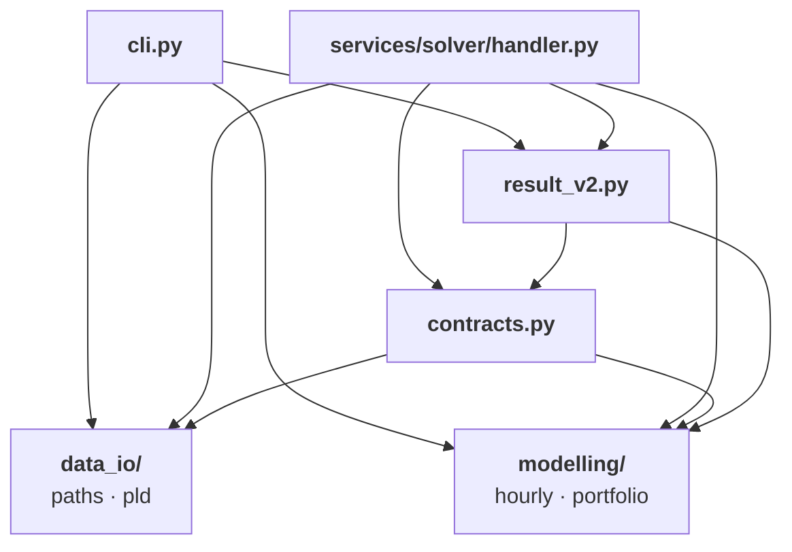

# Architecture

*How the Python package is structured, and the decisions inside it.*

[← README](../README.md) · [data](data.md) · [solve](solve.md) ·
[validation](validation.md) · [glossary](glossary.md)

---

> **Scope.** This document is the Python package, `src/battery_plan/`. The web
> platform built around it — the Go API and DLQ handler, the solver Lambda, the
> React site, the AWS stack — is drawn in the [README](../README.md#architecture).
> Its rules live next to the code: [`contracts/platform.md`](../contracts/platform.md)
> (storage, routes, quotas, refunds, the local stack),
> [`contracts/README.md`](../contracts/README.md) (the schemas),
> [`services/api`](../services/api/README.md),
> [`services/solver`](../services/solver/README.md), [`web`](../web/README.md) and
> [`deploy.md`](deploy.md). The financial layer is not in this package: it is
> TypeScript, in `web/src/finance/`, and never calls the solver.

## 1. The package

The formulation lives in [`model/model.md`](model/model.md) as numbered sections,
and the code cites them.

| Module | Sections | What it holds |
| --- | --- | --- |
| `data_io/paths.py` | | Where the bundled files are |
| `data_io/pld.py` | | The CCEE exports, the canonical file, its loader and the upload check |
| `modelling/hourly.py` | §2–§6 | `HourlyBattery`, the contract limits, and one program over the horizon: `solve_hourly` (merchant) and `solve_contracted` |
| `modelling/portfolio.py` | §6, §8.3 | The 4 × 2 grid, annualisation, ranking, regret and the 24+0 backtest |
| `contracts.py` | | A run request as an `HourlyBattery`, the span rule and the params hash ([contracts/](../contracts/README.md)) |
| `result_v2.py` | | The result a run stores and the web draws, and the plan CSV |
| `cli.py` | | `battery-plan inputs` and `dispatch` |

One dependency rule holds it together: **the model cannot read a file, and the
loaders cannot model.** `modelling/` takes prices as a pandas object and imports
nothing else of ours, and `data_io/` imports nothing from it. The two entry points,
`cli.py` and the Lambda handler, are where they meet.

## 2. Decisions

- **One program per horizon.** The merchant LP over 670 days takes seconds, so
  there is no decomposition to get wrong ([solve](solve.md)).
- **The binary is avoided whenever it can be.** `solve_contracted` solves the
  relaxation first and adds the 12 h binary only on the days that break the limit.
  A relaxed plan that respects the limit is already the MILP optimum (§6).
- **Submarkets are independent problems.** The battery is in one, so solving each
  and comparing is exact, and no location binary is needed.
- **The ranking comes from the merchant case.** The fixed revenue is the same in
  every submarket, so differences in the contracted case are effects of the proxy.
- **Physical inputs are hashed, financial ones are not.** The request holds only
  what changes the dispatch, so a change of capex or discount rate needs no run.
- **Time is local.** Prices stay on the market's clock, because moving them to UTC
  would shift the daily shape by three hours.
- **The model version is hashed.** A change that moves results bumps
  `MODEL_VERSION`, so earlier runs stop answering from the cache.
- **A time limit is an error.** A solve that runs out of time raises instead of
  returning a partial plan, and the run fails with its quota refunded.
