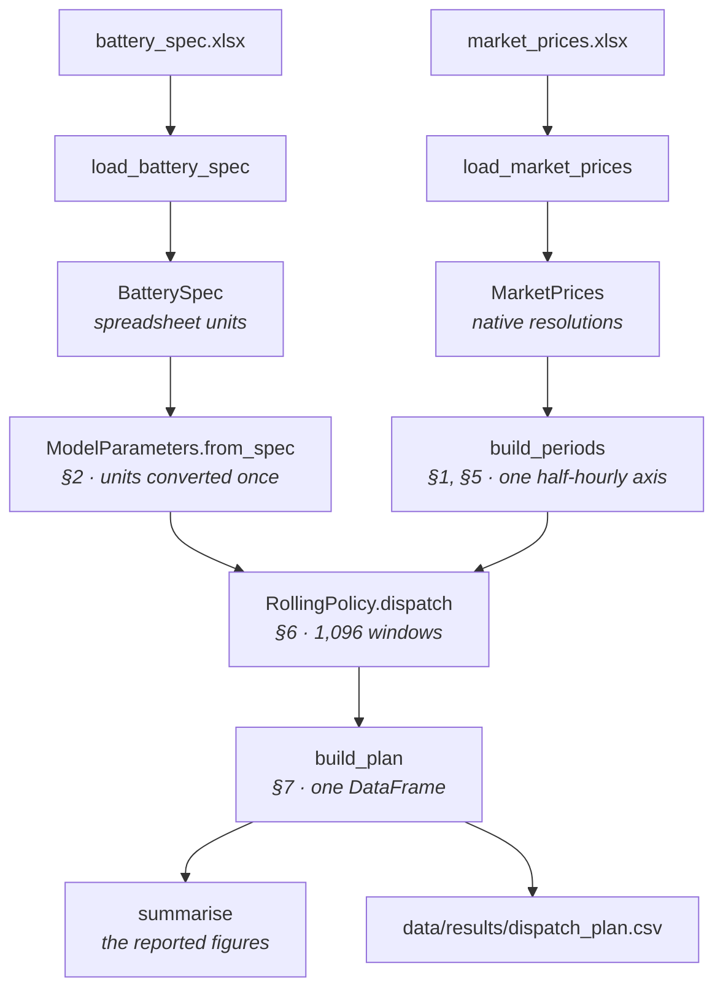
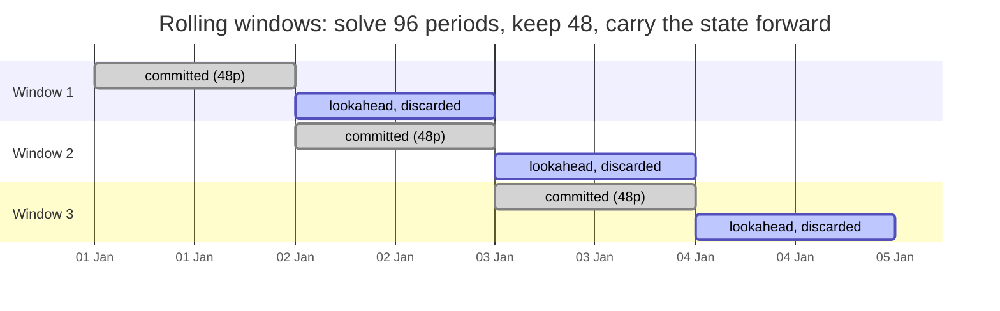
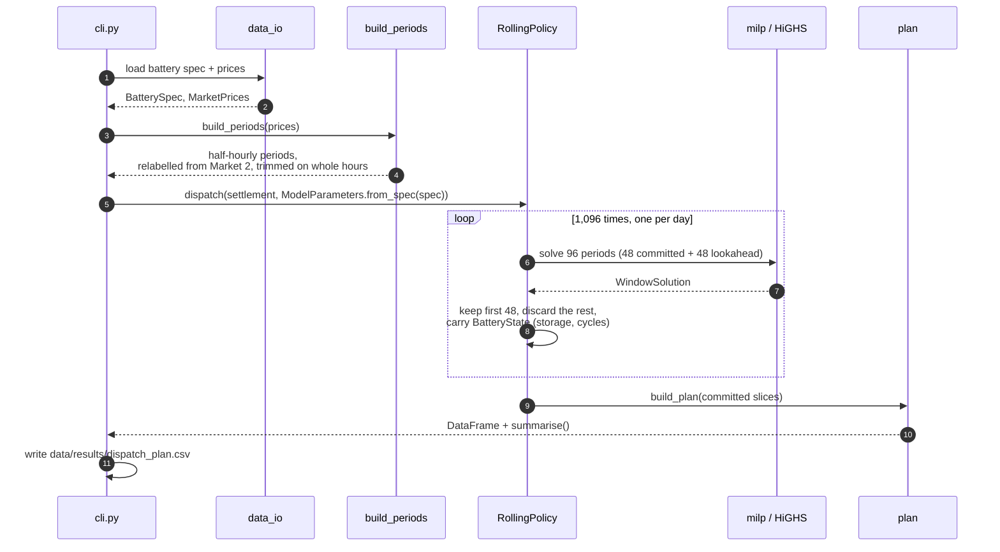

# What happens in a solve

*Why the horizon is decomposed, what one window does, and the evidence that a
day of foresight suffices.*

[← README](../README.md) · [architecture](architecture.md) ·
[cycle budget](cycle-budget.md) · [validation](validation.md) ·
[glossary](glossary.md)

---

## The pipeline

## Binary variables issue

`battery-plan dispatch` over a long horizon is **one mixed-integer program
per day**. The horizon carries a binary per period, the §4.3 exclusivity of
charging and discharging, and solve time grows steeply *and erratically* with
window length.

Running the whole horizon in one go is too heavy.

## Decomposing the problem

Each window is solved with a day of foresight and committed for only half of
what it solved. The lookahead exists so that the committed day is not decided as
if the world ended at midnight. It is then thrown away.

Two numbers cross each boundary, carried in a `BatteryState`: the **state of
charge** and the **cumulative cycle count**. The handover carries both exactly,
so the decomposition stays feasible. Only the cycle *budget*, which couples
periods arbitrarily far apart, needed [special handling](cycle-budget.md).

Both lengths are tunable from the CLI (`--commit-days`, `--lookahead-days`); a
web run always uses one day of each. Both
both must be a whole number of hours, so a Market 2 commitment is never split
across a boundary.

## End to end

One HiGHS instance is reused across every window. The full three years takes a
few minutes, with a progress line on stderr.

## Implementation details of the rolling loop

- Cost is linear in the horizon: 1,096 MILPs of fixed size (96 periods, 96
  binaries) rather than one over the whole horizon, whose difficulty grows faster than its
  length. One `HiGHS` solver object is built per pass and reused across every
  window.
- There are no warm starts. Consecutive windows differ only in their prices and
  their opening state, so each solve rebuilds a model much like the last one.
  This is the clearest remaining speed-up, and it is not implemented.
- The last window keeps what it has. `min(commit_periods, len(window))` commits
  the tail when the horizon does not divide evenly, and the final window has no
  lookahead to discard.
- Windows are whole hours by assertion. `__post_init__` rejects anything else,
  because an hourly Market 2 pair of §4.5 split across a boundary would let the
  two halves be committed to different prices.
- The handover is two floats. `state_after(committed)` reads *S* and *n_cyc* at
  the last committed period, the two quantities the next window's first-period
  constraints need.
- S_max is substituted rather than solved for. §4.7 lets the degraded capacity
  be folded into the storage bound (`storage[t] + volume * rho * n_cyc[t] <=
  volume`), which keeps a variable per period out of the full program.

## Is one day of foresight enough?

It is an assumption to check on each dataset. A store that can fill in two hours
makes decisions that rarely reach far beyond the day they are taken in, unless
the cycle budget couples distant days.
