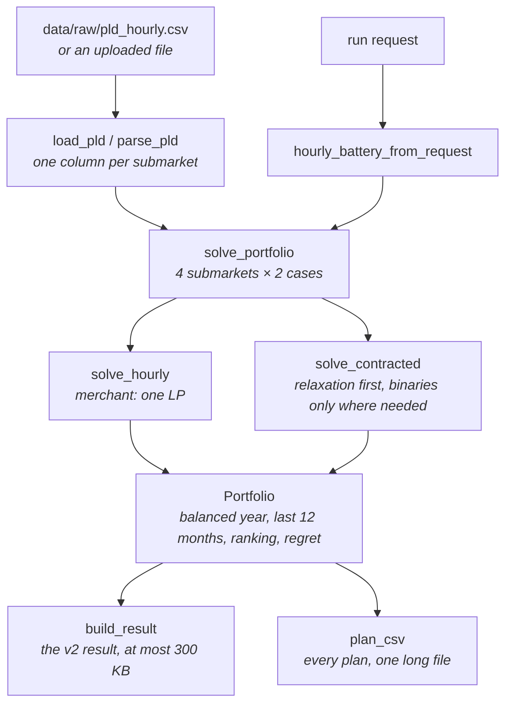

# What happens in a solve

*One program per submarket and case, what it costs on the real data, and how much
of its value an operator without foresight could capture.*

[← README](../README.md) · [data](data.md) · [architecture](architecture.md) ·
[validation](validation.md) · [glossary](glossary.md)

---

A solve is **one program over the whole horizon**, per submarket and case, in
`modelling/hourly.py` and `modelling/portfolio.py`.

- The merchant case is an LP, about 2.3 s and 245 MB for 670 days through PuLP. A
  24+24 h rolling window came within 0.03–0.12%, so the product has no windows.
- The contracted case solves the LP relaxation first. If no day exceeds 12
  injection hours that solution is the MILP optimum; otherwise the days that
  break the limit receive the binary `z_t`, and the solve repeats until none does.
- The perfect-foresight merchant value is a ceiling. A 24+0 backtest measures the
  capture factor.

## Measured: the hourly PLD engine

All figures come from `scripts/measure_pld_dispatch.py` on the 670 days of CCEE data (20/01/2025 to 20/11/2026), on a 20-thread development machine and not on a Lambda. The test battery delivers 1 MW for 4 h, with an RTE of 85%, 0.001% fade per cycle and the §2 default charge rate of `E / (6 η_c)`.

### The eight programs

| Submarket | Merchant, balanced year (BRL/MW-year) | Merchant, last 12 months | Merchant solve | Contracted solve |
| --- | --: | --: | --: | --: |
| SE | 234,912 | 291,133 | 1.96 s | 2.99 s |
| NE | 217,250 | 266,720 | 1.36 s | 2.28 s |
| N | 205,121 | 264,575 | 1.38 s | 2.28 s |
| S | 193,692 | 219,932 | 1.43 s | 2.31 s |

All eight take 17.4 s and peak at 285 MB. The values are nominal perfect-foresight ceilings, with no IPCA restatement.

**These differ from the planning figures** of BRL 244,498 and 298,910 for SE. Those assumed a charge limit of 1 MW on the grid side: the same program at that rate gives 244,503 and 298,920. The §2 default of 0.784 MW is 3.9% lower on the balanced year.

### The 12 h limit

The limit **did not bind on real prices**. Across 28 contracted configurations (4 to 24 h, four submarkets), no day of the relaxed plan exceeded 10 injection hours, so every one was settled by the LP, in at most 2.8 s. The daily limit of two contractual cycles caps delivery at `8P` MWh, which takes 8 h at full power whatever the battery's duration.

The MILP path was therefore forced, each solve capped at 150 s (a quarter of the Lambda's 600 s):

| Forced case | Configurations | Slowest | Result |
| --- | --: | --: | --- |
| Binary on all 670 days, 12 h limit | 8 | 57.8 s | all solved |
| Limit tightened to 10 h | 12 | 3.2 s | all settled by the LP |
| Limit tightened to 8 h | 12 | 17.4 s | all solved |
| Limit tightened to 6 h | 12 | 63.6 s | all solved |
| Limit tightened to 4 h, 4 h battery (140 s cap) | 4 | over 140 s | **2 of 4 timed out** (SE, NE) |

The first four rows ran as two concurrent processes, peaking at 809 MB against the Lambda's 1,769 MB. The whole 4x2 grid of an 8 h battery under a 6 h limit took 209 s and 515 MB. The 4 h row is not a contract setting: it is three times tighter than the 12 h of CRCAP 5.1.1(iii). A solve that reaches its time limit raises an error and never returns a partial plan.

The MILP stops at a **0.1% gap**. At 0.01% the 8 h limit on an 8 h battery no longer finished in 90 s, and at 0.001% it did not finish in 600 s. Case C's value is a proxy for the ONS dispatch and not revenue, so this tolerance does not reach the cash flows directly.

### Capture factor (24+0 backtest)

Each day is decided seeing that day's 24 prices and none of the next, with the state carried across midnight. The factor is the backtest value over the perfect-foresight value of the same battery.

| Duration | SE | S | NE | N | Range, last 12 months |
| --- | --: | --: | --: | --: | --: |
| 2 h | 0.981 | 0.975 | 0.967 | 0.968 | 0.981–0.989 |
| **4 h** | **0.980** | **0.972** | **0.965** | **0.965** | 0.978–0.988 |
| 6 h | 0.978 | 0.969 | 0.961 | 0.961 | 0.973–0.987 |
| 8 h | 0.966 | 0.956 | 0.950 | 0.949 | 0.956–0.971 |

This is still an **upper bound on what an operator captures**. It removes the view of tomorrow but keeps a perfect view of today's prices, and it includes no forecast error.

## The pipeline

The solver Lambda and `battery-plan dispatch` both call `solve_portfolio`. A
battery that cannot meet the contract's sizing rules gets the four merchant cases
only, and the result says why. A solve that reaches its time limit raises an error
and never returns a partial plan.
